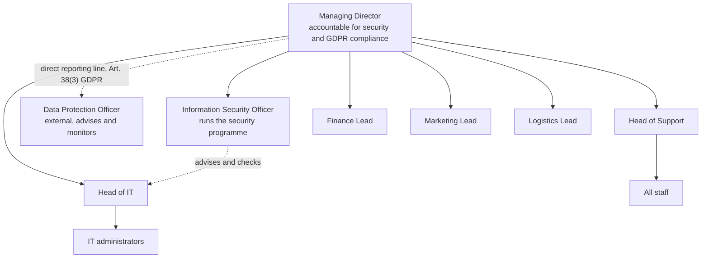

# Governance structure

ShopNova GmbH, version 1.0, 2026-11-16. Owner: Information Security Officer. Approved by: Managing Director.

## 1. Purpose

This document sets out who directs, runs and oversees information security and data protection at
ShopNova. It is the reference for every role named in the policies (POL-01 to POL-09), the RACI
matrix (`raci-matrix.csv`) and the asset owners in `../00-scope-and-setup/asset-register.csv`.

## 2. Reporting lines

## 3. Roles and responsibilities

These role names are used exactly as written in every policy and in the RACI matrix.

| Role | Held by | Main responsibilities |
|---|---|---|
| Managing Director | Geschäftsführer (executive management) | Accountable for information security and GDPR compliance (Art. 24 GDPR). Approves policies, accepts risks above appetite (POL-09), decides on breach notifications (POL-05), provides budget. |
| Information Security Officer | New role, 50% of one senior employee, reports directly to the Managing Director | Runs the security programme: policy set, risk register, DPIA coordination, incident lead, KPI reporting, awareness training. Monitors IT but does not run it. |
| Data Protection Officer | External DPO under a service contract | Informs and advises, monitors GDPR compliance, advises on DPIAs, is the contact point for the Berlin Commissioner for Data Protection and Freedom of Information (BlnBDI) (Art. 39 GDPR). |
| Head of IT | Existing role | Owns A-01, A-02, A-03, A-04 and A-07. Runs patching, access management, backups and laptop security. Technical lead in incidents. |
| IT administrators | IT team (privileged users, A-07) | Carry out changes, patches, access changes and restores; follow POL-04 for privileged access. |
| Head of Support | Existing role | Leads the support team that uses A-02 for customer service. Handles data subject requests (POL-03) and customer communication in a breach (POL-05). |
| Finance Lead | Existing role | Owns A-05 (payment provider integration) and its contract. |
| Marketing Lead | Existing role | Owns A-06 (email and newsletter provider) and the consent records (D-05). |
| Logistics Lead | Existing role | Owns A-08 (delivery partner) and its contract. |
| All staff | Every employee and contractor | Follow the policies, complete training, report suspected incidents at once (POL-05). |

## 4. Data Protection Officer: is one required?

§ 38(1) BDSG requires a DPO where, as a rule, at least 20 persons are constantly engaged in the
automated processing of personal data. Estimated head count with daily access to customer data:

| Team | People | Processes customer data daily? |
|---|---|---|
| Support | 10 | Yes (A-02, A-04) |
| Logistics / warehouse office | 6 | Yes (order and address data) |
| IT | 4 | Yes (A-01, A-02, A-03) |
| Marketing | 3 | Yes (D-05, campaign lists) |
| Finance | 3 | Yes (D-03, invoices) |
| **Total** | **26** | Threshold of 20 exceeded |

**Decision:** ShopNova must designate a DPO. An external DPO is chosen because a 50-person company
cannot staff the role internally without a conflict of interest. The Head of IT and the Managing
Director cannot be DPO, because they decide on the purposes and means of processing (see CJEU
judgment C-453/21, X-FAB, 9 February 2023, on conflicts of interest). The DPO's contact details are
published in the privacy notice and notified to the BlnBDI (Art. 37(7) GDPR).

## 5. Information Security Officer: placement

The Information Security Officer reports directly to the Managing Director and is not part of the IT
department. This separates "doing" (Head of IT) from "checking" (Information Security Officer), as
expected by ISO/IEC 27001:2022 A.5.3 (segregation of duties). The role and the DPO are held by
different people, so security and data protection give independent advice.

## 6. Governance forum

| Forum | Members | Frequency | Inputs | Outputs |
|---|---|---|---|---|
| Security and Privacy Steering Meeting | Managing Director (chair), Information Security Officer, Data Protection Officer, Head of IT; others on demand | Monthly, plus after any SEV-1 or SEV-2 incident | KPI report (`kpi-register.csv`), risk register changes, open CAs, incidents | Decisions and risk acceptances, recorded in minutes and in the decision log |

## 7. Policy framework

| Level | What it is | Approved by | Example |
|---|---|---|---|
| Policy (POL-xx) | What must be achieved, and who is responsible | Managing Director | POL-04 Access Control Policy |
| Standard | Measurable rules that implement a policy | Information Security Officer | Password and MFA standard |
| Procedure | Step-by-step instructions | Policy owner | Breach notification procedure (Phase 4) |

The policies are listed in `policy-register.csv`. Each one is mapped to ISO/IEC 27001:2022,
NIST CSF 2.0 and GDPR/BDSG in `framework-mapping.csv`.

## 8. Oversight and reporting

- The Information Security Officer reports the KPIs in `kpi-register.csv` to the steering meeting every month.
- The DPO reports to the Managing Director at least once a year, and at any time it is needed (Art. 38(3) GDPR).
- Each policy is reviewed once a year, or earlier after a significant incident or change (POL-01).

## 9. Assumptions

- Head counts and role holders are synthetic and chosen for the case study.
- ShopNova has no works council. If one existed, monitoring tools (for example the SIEM in Phase 4)
  would need its agreement (§ 87(1) no. 6 BetrVG).
- NIS2 (German implementation in the BSIG) is assumed not to apply. ShopNova sells its own goods
  and is not an online marketplace, search engine or cloud provider. To be confirmed with the lecturer.
