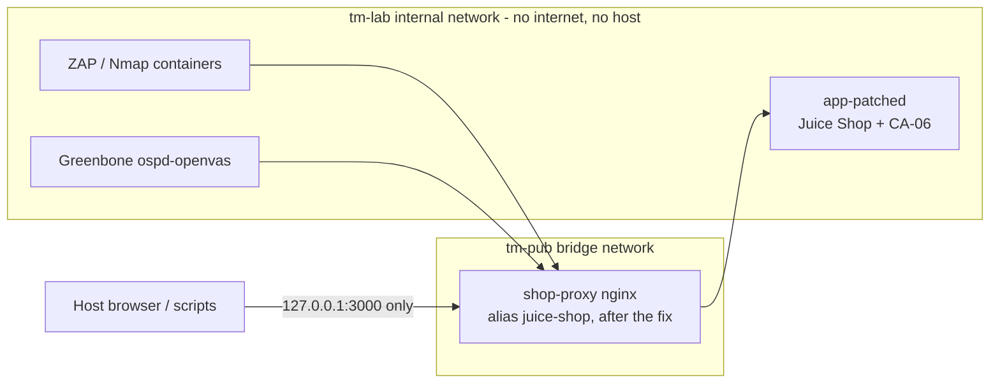

# Phase 3 lab: topology and commands

All lab services run in Docker on this machine. **Scope rule:** every scan and attack targets only the
local Juice Shop lab, either as `http://juice-shop:3000` on the internal network `tm-lab` or as
`http://127.0.0.1:3000` from the host. `tools/phase3_lab.py` refuses any other target.

## Topology



- **Before the fix:** the container `juice-shop` (bkimminich/juice-shop, image digest in `evidence/phase3/before/run-log.txt`) held the alias `juice-shop` on `tm-lab` and published 127.0.0.1:3000.
- **After the fix:** `shop-proxy` (nginx 1.27 + `fix/nginx-hardening.conf`) takes over the alias and the port, in front of `app-patched` (image `shopnova/juice-shop-patched:ca-06`, built from `fix/Dockerfile`). The scan target URL is unchanged.
- **Isolation:** `tm-lab` is an internal Docker network (`--internal`). The isolation check (`network-isolation.txt` in each evidence folder) shows that a container on `tm-lab` reaches Juice Shop but not the internet and not the host.
- **Greenbone:** the Greenbone Community Edition stack runs from `%USERPROFILE%\greenbone-community-container\docker-compose.yml` (outside the repository; web UI on 127.0.0.1 only). Its scanner container `ospd-openvas` is attached to `tm-lab`. The admin password was changed and is stored outside the repository.

## Commands (PowerShell, from the project root)

```powershell
# networks and the original target (before)
docker network create --internal tm-lab
docker network create tm-pub
docker run -d --name juice-shop --network tm-pub -p 127.0.0.1:3000:3000 bkimminich/juice-shop:latest
docker network connect --alias juice-shop tm-lab juice-shop

# evidence before the fix
py tools\phase3_lab.py before isolation nmap trivy zap-baseline zap-active sqli

# compare the two fix options (both on tm-lab only)
docker build -t shopnova/juice-shop-patched:ca-06 03-vulnerability\lab\fix
docker run -d --name app-patched --network tm-lab shopnova/juice-shop-patched:ca-06
docker run -d --name waf-test --network tm-lab -e BACKEND=http://juice-shop:3000 -e PORT=8080 owasp/modsecurity-crs:nginx
py tools\phase3_lab.py options fix-options

# final topology (after)
docker rm -f juice-shop waf-test
docker run -d --name shop-proxy --network tm-pub -p 127.0.0.1:3000:3000 `
  -v "${PWD}\03-vulnerability\lab\fix\nginx-hardening.conf:/etc/nginx/conf.d/default.conf:ro" nginx:1.27
docker network connect --alias juice-shop tm-lab shop-proxy
py tools\phase3_lab.py after isolation nmap trivy zap-baseline zap-active sqli
```

## Files

| File | Purpose |
|---|---|
| `zap_login_ascan.py` | Targeted ZAP active scan of the login request only (a baseline scan is passive and cannot find SQL injection) |
| `fix/login.original.js` | The vulnerable login route copied from the image (line 70 after the MIT header: string-built SQL; one third-party e-mail redacted) |
| `fix/login.js` | The patched route: bound parameters (`$email`, `$password`) |
| `fix/Dockerfile` | Builds the patched image from the original by replacing only `login.js` |
| `fix/nginx-hardening.conf` | Hardening proxy: security headers, CORS fix, blocked paths |
