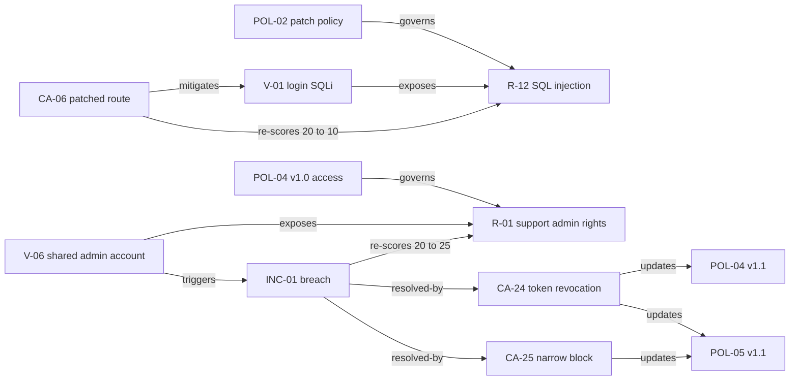

# Phase 5 summary: integration

ShopNova GmbH, 2026-11-17. This phase closes the loop. Evidence from the vulnerability cycle (Phase 3)
and the incident (Phase 4) flows back into the risk register and the KPIs (Phase 2), and into the
policies (Phase 1). All times are UTC (Berlin = UTC+1).
The incident timeline is a compressed lab simulation, not a measurement of production speed.

## 1. Re-scored risks

The full table, with the basis for each score, is in `risk-rescoring.md`. The heat maps (before, after,
target) are in `../02-risk/risk-heatmap.md`. Both are generated from the register.

| Level | Before (Phase 2) | After (re-scored) | Target |
|---|---|---|---|
| Critical | 2 | 2 | 0 |
| High | 9 | 7 | 0 |
| Medium | 5 | 6 | 9 |
| Low | 1 | 2 | 8 |

Five risks changed score:

| Risk | Change | Why |
|---|---|---|
| R-12 SQL injection | 20 down to 10 (Critical to High) | V-01 fixed and verified (CA-06). Not lower, because only the login request was scanned and the WAF is not deployed |
| R-17 misconfiguration | 12 down to 3 (High to Low) | V-03 and V-04 fixed and verified (CA-19, CA-20) |
| R-11 breach not detected or notified in time | 16 down to 8 (High to Medium) | INC-01 exercise: detected in 18 s, decision 55 s after awareness. Not lower, because the lab is compressed and detection covers few patterns |
| R-01 support admin rights | 20 **up** to 25 (stays Critical) | It happened (INC-01). Containment closes two endpoints, but the admin rights, the shared account and the missing MFA remain |
| R-03 vulnerable components | 16 **up** to 20 (High to Critical) | V-05: Trivy shows 116 known CVEs, 7 Critical, including authentication bypasses. **CA-21 is open until 2026-11-24, so this is not scored as fixed** |

Twelve risks were not tested in the lab and keep their Phase 2 score. That is the honest result: a lab
can confirm or refute only the risks it actually touches.

Two Critical risks remain (R-01, R-03), each under a temporary exception by the Managing Director until
2026-11-24, when CA-01, CA-02 and CA-21 are due. POL-09 allows such an exception for at most 60 days.

## 2. KPI results

The full table is in `kpi-results.md`. Every value is labelled by where it comes from.

| KPI | Value | Type |
|---|---|---|
| KPI-01 time to fix Critical findings | 0.13 h (V-01, 17:15:07 to 17:23:05) | measured in the lab |
| KPI-02 Critical and High fixed on time | 100% (1 of 1 due) | measured in the lab |
| KPI-05 awareness to notification decision | 55 s (0.02 h) | simulated |
| KPI-06 time to detect | 18 s | measured in the lab |
| KPI-10 High and Critical risks with a plan | 100% (9 of 9) | derived from the register |

The other six KPIs (KPI-03, 04, 07, 08, 09, 11) are **not measured**, because the lab has no
equivalent: no identity provider, training, restore test, supplier review or data subject requests.

**The lab values are not production values.** The attack, detection and decisions happened within three
minutes because the lab compresses time. The detection job ran right after the attack, and the
management decisions were a tabletop exercise. They show that the process and the tools work, not how
fast ShopNova would really be.

## 3. The closed loop

Every arrow is a row in `../traceability.csv`. The two chains show the two directions of the loop:

- **Prevention (R-12).** A policy governs a risk; a scan finds the vulnerability; a corrective action
  fixes it; the risk is re-scored downwards.
- **Learning (R-01).** A known, accepted risk materialises as an incident. The incident produces
  corrective actions, and those change the policies themselves (POL-04 and POL-05 v1.1). The risk is
  re-scored upwards, because evidence beats judgement.

## 4. Policy changes (version 1.1)

| Policy | Change | From |
|---|---|---|
| POL-04 v1.1 | New statement 10: invalidate all tokens on a password reset; staff tokens valid for at most 1 hour. Known gap: exception shortened to 2026-11-24; the false compensating control ("not shared") corrected | CA-24, INC-01 review |
| POL-05 v1.1 | Statement 10: containment revokes tokens; emergency blocks are narrow and keep sign-up, login and checkout working; containment is re-verified after restarts | CA-24, CA-25, INC-01 review |

CA-25 was implemented and tested in the lab: sign-up 201, user-data reads 403
(`../evidence/phase5/ca25-containment-narrowed.json`). The same test first showed that a Docker restart
had undone the CA-23 password reset (`../evidence/phase5/ca25-test-run1-reset-lost-after-restart.json`).
That finding became the third rule in POL-05 v1.1 statement 10.

## 5. Lessons learned

1. **Accepted Critical risks are bets.** R-01 was accepted for four weeks and materialised within one day.
   The review recommends a 14-day maximum for exceptions on customer-data risks.
2. **Fixing one vulnerability moves the attacker, not the risk.** Closing V-01 forced the INC-01
   attacker to use a stolen password instead. Prevention needs depth: least privilege (CA-01) and MFA
   (CA-02), not just patches.
3. **Scans find risks the register missed.** R-17 and the data category D-06 came from Phase 3, not from
   the desk-based risk assessment.
4. **Evidence can raise scores.** R-01 and R-03 went up after testing. A process that only ever lowers
   scores is not measuring anything.
5. **Containment must survive change.** A password reset was lost on restart, and tokens survived a
   password change. Both are now policy rules.
6. **Detection is cheap to start.** Four rules over an ordinary access log detected the breach in seconds.
   No SIEM was needed for this pattern, though a SIEM would add user context (CA-15).
