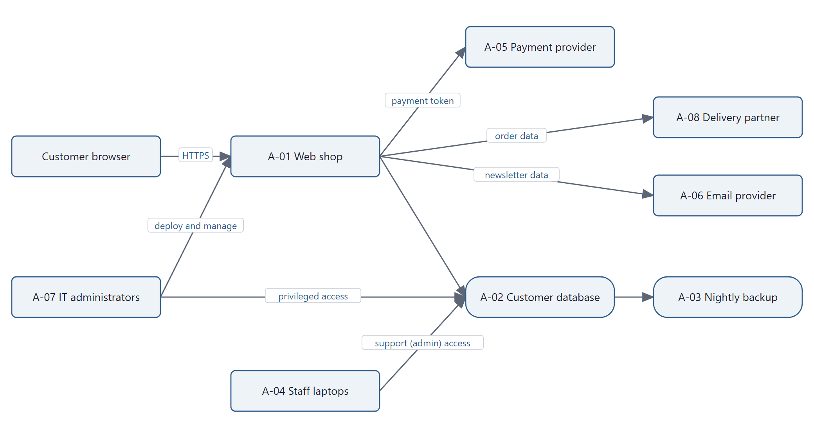

# 1 Introduction and scope

## 1.1 Purpose of the report

Many organisations treat governance, risk management, vulnerability management and incident response as
four separate activities. Each has its own owner, documents and tools. This report shows how the four can
work as one managed process for a small company that holds personal data of EU customers. The company is
held accountable under the GDPR for the results of all four together.

The report follows one case company from scope definition to a simulated personal data breach. Every
claim can be traced to an artefact in the project repository. Items carry permanent IDs, for example
POL-02 for a policy, R-12 for a risk, V-01 for a vulnerability and CA-06 for a corrective action, and
every link between them is recorded in `traceability.csv`.

## 1.2 Case company

ShopNova GmbH is a fictional online shop for consumer electronics accessories, based in Berlin. All data
in this project is synthetic.

| Characteristic | Value |
|---|---|
| Employees | about 50 |
| Registered customers | about 20,000, in the EU |
| Hosting | cloud, EU region (web shop, customer database, nightly backups) |
| Third parties | payment provider (tokenised card data), email and newsletter provider, delivery partner |
| End-user devices | about 40 laptops, partly used for remote work |
| Supervisory authority | Berlin Commissioner for Data Protection and Freedom of Information (BlnBDI) |
| Starting maturity | basic: no formal policies, ad hoc patching, no tested incident response plan |

## 1.3 Scope

**In scope** (asset IDs from `00-scope-and-setup/asset-register.csv`):

- the public web shop and its hosting (A-01);
- the customer database and backups (A-02, A-03);
- staff laptops and the IT administrators with privileged access (A-04, A-07);
- the integrations with the payment provider, email provider and delivery partner (A-05, A-06, A-08);
- the processes of governance, risk management, vulnerability management and incident response.

**Out of scope:** physical security of buildings, the internal systems of third-party providers, and the
HR and payroll system.

Five categories of customer personal data are processed (D-01 to D-05: identity, delivery address, payment
reference, account credentials, marketing consent). For each one, the data inventory records the purpose,
legal basis under Art. 6 GDPR, storage location, access roles, retention period and recipients. The data
flow between assets is drawn in `00-scope-and-setup/data-flow.mmd` and shown in Figure 1.

One weakness was kept in the case on purpose, because it is typical of a company at basic maturity:
**support staff hold administrator rights on the customer database (A-02).** It is followed through every
chapter: POL-04 records it as a known gap, it becomes risk R-01, and it is the entry point of the
simulated incident INC-01.

## 1.4 Method

The project was built in seven phases. Each phase ends with an automated validation script that checks
completeness, ID formats and cross-references.

| Phase | Output | Validator |
|---|---|---|
| 0 Scope and setup | asset register, data inventory, data flow, ID scheme | `validate_phase0.py` |
| 1 Governance | roles, nine policies, framework mapping, KPIs, gap assessment | `validate_phase1.py` |
| 2 Risk management | risk register, treatment plan, heat map, DPIA | `validate_phase2.py` |
| 3 Vulnerability management | scans of a local lab, vulnerability register, fixes, rescans | `validate_phase3.py` |
| 4 Incident response | simulated breach, detection, Art. 33/34 notifications, review | `validate_phase4.py` |
| 5 Integration | re-scored risks, KPI results, policy updates | `validate_phase5.py` |
| 6 Report | this document | `check_report_numbers.py` |

The reference frameworks are ISO/IEC 27001:2022 (ISO/IEC, 2022a), NIST CSF 2.0 (NIST, 2024), and the GDPR
together with the German BDSG. No assignment brief was available, so this choice is an assumption, recorded
in the decision log for confirmation with the lecturer. The technical work in Phases 3 and 4 uses a local
Docker lab. OWASP Juice Shop, a deliberately vulnerable web shop, stands in for ShopNova's shop (A-01).
Every scan targets only that local container.

## 1.5 Assumptions and limitations

- The company, its staff numbers, its scores and its approvals are fictional. Management sign-offs and DPO
  advice are marked "simulated".
- The current maturity is taken from the case description, not from an audit.
- The lab application is not ShopNova's real code. Findings show how the process works, not what
  ShopNova's real exposure is.
- Legal statements reflect German and EU law as of November 2026. Two of them should be confirmed with the
  lecturer: which suppliers are processors, and whether NIS2 applies.

## 1.6 Structure of the report

Chapter 2 sets up governance. Chapter 3 identifies and treats risks. Chapter 4 runs a vulnerability
management cycle. Chapter 5 simulates and handles a personal data breach. Chapter 6 feeds the
evidence back into risks, KPIs and policies. Chapter 7 states the limitations, and Chapter 8
concludes. Appendix A lists the evidence files, and the references follow at the end.
All times are UTC (Berlin = UTC+1).
