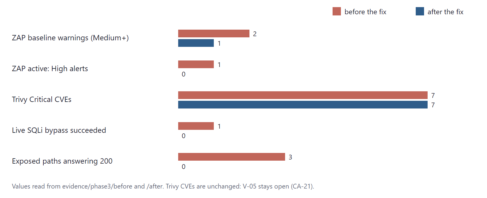

# 4 Vulnerability management

This chapter runs one full cycle of POL-02 against a local lab: discover, assess, prioritise, fix, then
verify by rescanning (`03-vulnerability/`). It is also the first run of the monthly scanning action CA-05.

## 4.1 Lab and scope

ShopNova's web shop (A-01) is represented by OWASP Juice Shop 20.4.0-SNAPSHOT (Kimminich, 2026), a
deliberately vulnerable shop application.

- **Reachability.** The shop runs in Docker and is reachable only on 127.0.0.1:3000 and on an internal
  Docker network (`tm-lab`) that has no route to the internet or to the host.
- **Isolation check.** A probe at the start and end of the cycle confirmed that a container on that
  network reaches the shop and nothing else (`network-isolation.txt`).
- **Scope rule.** Every scan targeted only the lab shop. The Phase 3 validator checks every Nmap and ZAP
  command in the run logs against this rule.

## 4.2 Discovery: the same steps before and after the fix

| Step | Tool | Before the fix | After the fix |
|---|---|---|---|
| Ports and services | Nmap (Lyon, 2009), `-sV -sC -p-` | 1 open port (3000), wildcard CORS header | 1 open port, now served by the hardening proxy |
| Image dependencies | Trivy (Aqua Security, 2026) | 116 known CVEs: 7 Critical, 23 High, 69 Medium, 15 Low, 2 Unknown | unchanged (116), same libraries |
| Passive web scan | ZAP baseline (ZAP, 2026) | 3 warnings (2 Medium, 1 informational): CSP header not set, cross-domain misconfiguration, modern web application | 2 warnings (1 Medium, 1 informational): CSP `style-src 'unsafe-inline'`, modern web application |
| Active scan of the login | ZAP active scan, one request | SQL Injection (High) in the `email` parameter | no SQL injection |
| Live attack | login with `' OR 1=1--` | HTTP 200, logged in as `admin@juice-sh.op` (17:16:40 UTC) | HTTP 401, no token (17:23:05 UTC) |
| Manual check | robots.txt, then /ftp, /support/logs | files and access logs public | HTTP 403 |

**A ZAP baseline scan cannot find SQL injection.** It only reads responses and never sends attacks.
The injection was found by a targeted active scan of the single login request, then confirmed by the live
attack. This kept the active testing short and inside the agreed scope.

**Two runs were repeated, and both attempts are kept in the run logs:**

- **Trivy:** the first run timed out while downloading its vulnerability database.
- **ZAP baseline after the fix:** the first run showed two gaps in the proxy configuration, so the
  configuration was tightened and the scan repeated.

## 4.3 Assessment and prioritisation

Six findings were recorded in `vulnerability-register.csv`. V-06 was added later, from the incident.

| ID | Finding | CVSS 3.1 | Business priority | Risk | Fix | Status |
|---|---|---|---|---|---|---|
| V-01 | SQL injection in the login | 9.8 Critical | P1, 3 days | R-12 | CA-06 (CA-07 tested) | Fixed |
| V-02 | CSP header not set | 4.3 Medium | P2, 30 days (raised) | R-13 | CA-16 | Fixed (residual) |
| V-03 | Wildcard CORS | 4.3 Medium | P3, 90 days | R-17 | CA-19 | Fixed |
| V-04 | Exposed /ftp, access logs, keys | 5.3 Medium | P2, 30 days (raised) | R-17 | CA-20 | Fixed |
| V-05 | 116 vulnerable libraries | 9.8 Critical (CVE-2015-9235) | P1, 7 days | R-03 | CA-21 | Open, due 2026-11-24 |
| V-06 | Shared support account with admin role | 8.1 High | P1, 3 days (raised) | R-01 | CA-01 (CA-22, CA-23) | Mitigated |

CVSS measures technical severity, not business impact (FIRST, 2019). Business priority therefore starts
from the CVSS severity and may be **raised by at most one level** for ShopNova's context, as POL-02
statement 3 allows:

- **internet exposure:** the system can be reached from the internet;
- **personal data:** the finding touches customer data;
- **known exploitation:** the vulnerability is known to be used in attacks.

Two medium findings were raised:

- **V-02:** a missing CSP matters more on a shop whose checkout could be skimmed (R-13).
- **V-04:** the public logs contain customer IP addresses.

The deadlines follow POL-02 statement 4. V-01 got the 72-hour deadline, because it was exploited and is
internet-facing. The validator recalculates every CVSS score from its vector and checks every priority
and deadline against these rules.

## 4.4 Fixing V-01: two options compared

Two fixes for the SQL injection (R-12) were tested with the same requests from inside the lab network
(`fix-options.md`):

| Request | Unpatched app | Option A: WAF (ModSecurity CRS) | Option B: patched login route |
|---|---|---|---|
| `' OR 1=1--` | 200, token issued | 403 | 401 |
| `admin@juice-sh.op'--` | 200, token issued | 403 | 401 |
| Real user, correct password | 200 | 200 | 200 |

Both options stopped both payloads without blocking real users.

- **Option B is the fix (CA-06).** It changes one line, so that the query uses bound parameters, which
  removes the flaw itself (OWASP, 2021).
- **Option A, the WAF (CA-07), stays as a tested backup layer.** A WAF only matches attack patterns, and
  rule sets can be bypassed. POL-02 statement 6 reserves it for virtual patching while a code fix is not
  yet available.

Three more findings (V-02, V-03, V-04) were fixed by an nginx hardening proxy in front of the patched
app: it adds security headers, removes the wildcard CORS header and blocks /ftp, /encryptionkeys and
/support/logs. The proxy took over the same address and network name, so the "after" scans used exactly
the same target as the "before" scans.

**The hardening caused a regression.** The new Content Security Policy blocked two inline scripts of
the shop, including the one that activates its main stylesheet, so icons and layout broke. The
security scans could not see this; it was found in the browser. Both scripts are now allowed by
their SHA-256 hashes rather than by `'unsafe-inline'`, and the repeated ZAP baseline gives the same
result. Because the CSP allows the two inline scripts by their SHA-256 hashes, the hashes must be
recomputed whenever the shop's page changes, for example after an update. This is a maintenance cost of
the approach. Every hardening change needs a functional test as well as a security scan.

## 4.5 What stayed open

**V-05 remains open.** The 116 library vulnerabilities include authentication bypasses
(CVE-2015-9235 in jsonwebtoken, CVE-2020-15084 in express-jwt). Fixing them means upgrading dependencies
in the source code and rebuilding, which this lab cannot do. CA-21 tracks the work with the POL-02
deadline of 2026-11-24. A WAF cannot help here, because a forged token looks like a valid one. Chapter 6
therefore raises R-03 instead of lowering it.

**Greenbone produced no usable result.** Greenbone Community Edition was set up as the planned network
vulnerability scanner, attached to the lab network, with its admin password changed.
- **Run 1:** the scanner had failed to load its tests, so the scan finished empty in 27 seconds.
- **Run 3** (run 2 failed on a duplicate target name), after one restart of the scanner: it reached the
  host (ICMP OS fingerprint) but did not detect or test port 3000.

Chapter 7 records this limitation, and the full log is in `03-vulnerability/phase3-summary.md`.

## 4.6 Feedback into the other layers

The cycle changed earlier phases, which is the point of an integrated process:

- **A new risk.** The scans found a misconfiguration that no Phase 2 risk covered: exposed files, public
  logs and wildcard CORS. It was added as R-17, with CA-19 and CA-20.
- **A new data category.** The public access logs showed that ShopNova's logs hold personal data (IP
  addresses) that the Phase 0 data inventory had missed. They were added as D-06.
- **KPIs.** KPI-01, the time to fix Critical findings, was 0.13 hours (8 minutes) for V-01, from the ZAP
  alert at 17:15:07 UTC to the verified fix at 17:23:05 UTC. This is a compressed lab time, not a
  production estimate. KPI-02 stands at 100% (1 of 1 due), with V-05 and V-06 not yet due.
