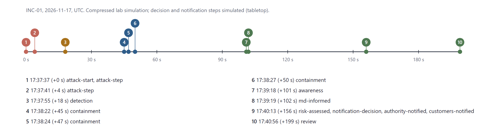

# 5 Incident response

This chapter simulates and handles a personal data breach, INC-01, under POL-05 (`04-incident/`). The
attack ran against the same local lab as Chapter 4. Detection used the shop's own logs, not a SIEM. The
human steps were run as a tabletop exercise: informing management, deciding, notifying. All times are
UTC (Berlin = UTC+1), and the timeline is a **compressed lab simulation**.

## 5.1 Scenario

The scenario turns the deliberate weakness of the case into an incident. An attacker phishes the password
of the shared support account. As at ShopNova (R-01), the account holds administrator rights. The SQL
injection from Chapter 4 was already fixed, so the attacker needs a real password: a realistic next step
once one door is closed.

The attack script (`tools/phase4_attack.py`) logged in through the normal shop entry point and then:

- downloaded the user list and the authentication details of all accounts;
- requested every account one by one.

It sent 28 requests between 17:37:37 and 17:37:41 UTC. All 24 lab accounts were exposed: email address,
username, role, last login IP address and account dates. The application masked the password field and
the two-factor secrets. In the ShopNova scenario the same requests return all of about 20,000 customer
accounts, so the assessment uses that scale.

## 5.2 Detection

The detection script (`tools/phase4_detect.py`) reads the nginx access log of the shop proxy and applies
four rules:

| Rule | Logic | Fired |
|---|---|---|
| 1 | Admin user-data endpoints accessed | yes, 26 requests |
| 2 | 20 or more API requests from one client within 60 seconds | yes, 28 requests |
| 3 | Login followed by admin data access within 5 minutes | yes |
| 4 | SQL injection indicators | no, correctly: the attacker used valid credentials |

The first alert was raised at 17:37:55 UTC, **18 seconds after the attack started** (KPI-06, measured in
the lab). In the lab the detection job ran right after the attack. With a 15-minute schedule in
production, the worst case would be about 15 minutes, still well inside the 24-hour KPI target.

## 5.3 Containment

| Time (UTC) | Action | Action ID |
|---|---|---|
| 17:38:22 | Support account password reset | CA-23 |
| 17:38:24 | Proxy rule blocks the admin user-data endpoints | CA-22 |
| 17:38:27 | Attack replayed: login refused (401), endpoints blocked (403). Contained 50 seconds after the attack started | |

The password reset alone would not have been enough. The application's login tokens (JWTs) stay valid
after a password change, so the attacker's existing token would have kept working. Closing the endpoints
was necessary, and token revocation became corrective action CA-24.

The block also had a side effect: it stopped new customer sign-ups, because sign-up uses the same
endpoint (`POST /api/Users`). CA-25 narrowed the rule in Phase 5, and a test confirmed sign-up works
(201) while reading user data stays blocked (403).

## 5.4 Breach assessment and notification

Awareness, in the sense of Art. 33 GDPR, was recorded at 17:39:18 UTC, once triage confirmed that personal
data had been accessed. Containment had already begun, because the IT team acts on a security incident
before it is formally classified as a personal data breach. The 72-hour deadline therefore runs to
**2026-11-20 17:39 UTC**.

The breach assessment (`INC-01-breach-assessment.md`) follows EDPB Guidelines 9/2022 (EDPB, 2023), with
the ENISA severity method as a cross-check (ENISA, 2013):

| Question | Decision |
|---|---|
| Personal data breach (Art. 4(12))? | Yes: confidentiality breach of D-01 and D-06 |
| Notify the BlnBDI (Art. 33)? | Yes: malicious actor, large volume; a risk cannot be ruled out |
| High risk (Art. 34)? | No: no passwords, payment or sensitive data; ENISA severity 1.5 ("Low") |
| Inform customers? | Yes, voluntarily, with the content of Art. 34(2) |
| Severity (POL-05) | SEV-1 (more than 1,000 customers) |

**The "not high risk" conclusion is a judgement.** The factors pulled in both directions:

- **Lower:** the secrets were masked, and the data is contact data only.
- **Higher:** about 20,000 people, easy identification, and malicious intent.

**Another assessor could reasonably decide differently.** Weighing the scale and the phishing risk more
heavily would make Art. 34 communication mandatory. Because ShopNova informs customers voluntarily with
the same content, customers receive the same information either way. The difference is the legal
obligation, not the practical outcome.

**The notification texts.**

- **To the BlnBDI** (`INC-01-art33-notification.md`): covers the four elements of Art. 33(3), namely
  the nature of the breach with categories and approximate numbers, the DPO contact, the likely
  consequences, and the measures taken.
- **To customers** (`INC-01-art34-customer-notice.md`): explains in plain language what happened, what
  was and was not affected, and how to recognise phishing in ShopNova's name.

## 5.5 Timeline and deadlines

| Time (UTC) | Event |
|---|---|
| 17:37:37 | Attack starts: login with the phished support password |
| 17:37:41 | Last attacker request |
| 17:37:55 | Detection: three High alerts |
| 17:38:22–17:38:27 | Containment and verification |
| 17:39:18 | Awareness: personal data breach confirmed |
| 17:39:19 | Managing Director and DPO informed (simulated) |
| 17:40:13 | Risk assessed; decision; BlnBDI notified; customers informed (all simulated) |
| 17:40:56 | Post-incident review (simulated) |

`tools/breach_clock.py` checks the timeline against three milestones:

- Managing Director informed within 1 hour;
- risk assessment within 24 hours;
- BlnBDI notified within 72 hours.

All three were met. The time from awareness to the notification decision was 55 seconds (KPI-05,
simulated). The four simulated steps share one timestamp because they were recorded together once their
documents were finished. Real decisions would take hours, which is why these figures say little about
real performance.

## 5.6 Post-incident review

The review (`INC-01-post-incident-review.md`) found five root causes:

1. Support holds admin rights it does not need (R-01, V-06).
2. The support account is shared, which breaks POL-04 statement 2.
3. There is no MFA (CA-02).
4. Tokens survive a password change (CA-24).
5. The admin endpoints have no volume limit.

It also found that the accepted exception for R-01, Critical for four weeks, materialised within one day.
Its actions:

- **New actions:** CA-22 to CA-25.
- **Earlier deadlines:** CA-01 and CA-02 brought forward to 2026-11-24.
- **Policy changes:** both policies updated to version 1.1, as described in Chapter 6.

**A further lesson appeared during Phase 5.** Docker restarted at 18:04 UTC, and the lab app re-created
its database, silently undoing the password reset. The CA-25 test found it at 18:09 UTC, and the reset
was re-applied. Containment that lives in application state has to be verified again after every
restart.
