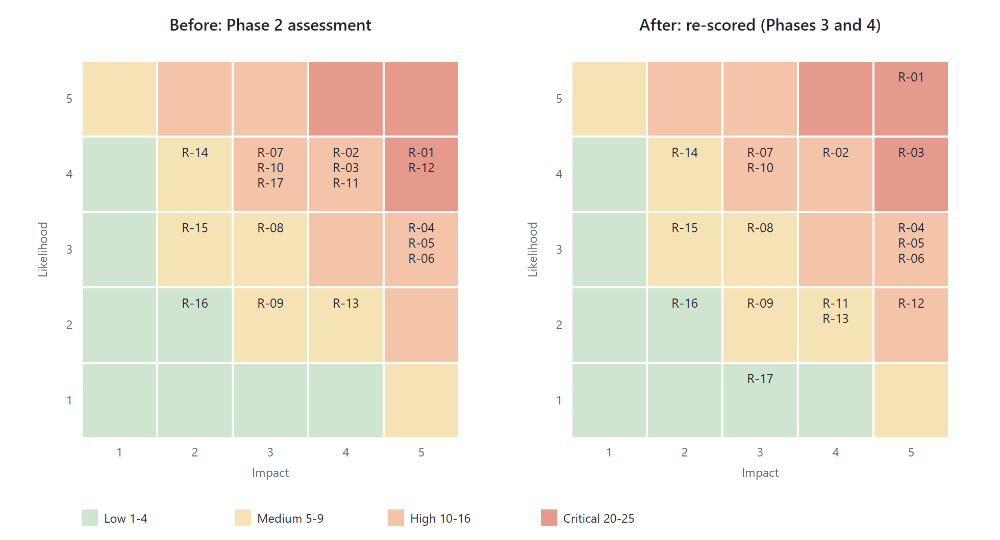

# 6 Integration: closing the loop

Chapters 2 to 5 produced policies, risks, vulnerabilities and an incident. This chapter feeds the evidence
of Chapters 4 and 5 back into the risk register, the KPIs and the policies (`05-integration/`). Together,
these links make the four layers one managed process.

## 6.1 Re-scoring the risks with evidence

Every risk was re-scored on 2026-11-17. The Phase 2 scores are kept as the "before" state, and each new
score names its evidence (`05-integration/risk-rescoring.md`).

| Level | Before (Phase 2) | After (re-scored) | Target |
|---|---|---|---|
| Critical | 2 | 2 | 0 |
| High | 9 | 7 | 0 |
| Medium | 5 | 6 | 9 |
| Low | 1 | 2 | 8 |

**The target has not been reached.** The target column is the treatment plan from Chapter 3: 0 Critical
and 0 High once every action is done. On 17 November 2026 the register shows 2 Critical and 7 High risks,
for three reasons:

- most actions are only due between 2026-11-24 and 2027-02-28;
- untested risks keep their Phase 2 score;
- two risks went up after testing.

The "before" column has 17 risks: the 16 from Chapter 3 plus R-17, which was added in Chapter 4. Five
risks changed score:

| Risk | Before | After | Evidence |
|---|---|---|---|
| R-12 SQL injection | 20 Critical | 10 High | V-01 fixed and verified (CA-06). Not lower: only the login was scanned, and the WAF is not deployed |
| R-17 misconfiguration | 12 High | 3 Low | V-03 and V-04 fixed and verified (CA-19, CA-20) |
| R-11 breach not detected or notified | 16 High | 8 Medium | INC-01: detected in 18 s, decision in 55 s. Not lower: compressed lab, few detection rules |
| R-01 support admin rights | 20 Critical | 25 Critical | INC-01 happened; the root causes CA-01 and CA-02 are still open |
| R-03 vulnerable components | 16 High | 20 Critical | V-05: 116 CVEs, 7 Critical, authentication bypasses; CA-21 open until 2026-11-24 |

**V-05 is not scored as fixed.** The Phase 5 validator enforces this rule: a risk exposed by an open
vulnerability may not be re-scored below its Phase 2 score. R-03 therefore went up, not down.

**Two risks went up.** A risk process that only ever lowers scores measures effort, not risk. The two
remaining Critical risks (R-01, R-03) are each under a temporary exception by the Managing Director until
2026-11-24, when their actions are due. POL-09 allows such an exception for at most 60 days.

**Twelve risks keep their Phase 2 score**, because the lab did not test them: phishing, admin accounts,
ransomware, cloud configuration, credential stuffing, laptops, suppliers, processor contracts, skimming,
retention, data subject requests and consent records.

## 6.2 KPI results

| KPI | Value | Type |
|---|---|---|
| KPI-01 time to fix Critical findings | 0.13 h (V-01) | measured in the lab |
| KPI-02 Critical and High fixed on time | 100% (1 of 1 due) | measured in the lab |
| KPI-05 awareness to notification decision | 55 s (0.02 h) | simulated |
| KPI-06 time to detect | 18 s | measured in the lab |
| KPI-10 High and Critical risks with a plan | 100% (9 of 9) | derived from the register |

The other six KPIs (KPI-03, 04, 07, 08, 09, 11) were **not measured**. The lab has no identity
provider, training records, restore tests, supplier reviews or data subject requests to measure them on.

**All lab values are compressed.** The attack, detection and decisions happened within about three
minutes, and the decisions were a tabletop exercise. The values show that the process and the tools
work. They are not estimates of ShopNova's real speed. The full table with evidence files is in
`05-integration/kpi-results.md`.

## 6.3 Policies changed by the incident

The incident led to changes in two policies, which completes the loop from incident back to governance:

| Policy | Change | Corrective action |
|---|---|---|
| POL-04 Access Control, version 1.1 | New statement 10: every token is invalidated on a password reset; staff tokens are valid for at most 1 hour. Known gap: exception shortened to 2026-11-24, and the false compensating control "support accounts are named, not shared" corrected | CA-24 |
| POL-05 Incident Response, version 1.1 | Statement 10: containment revokes tokens; emergency blocks are narrow and keep sign-up, login and checkout working; containment is re-verified after restarts | CA-24, CA-25 |

The links are recorded in `traceability.csv` as `INC-01 resolved-by CA-24` and `CA-24 updates POL-04`,
and the same for CA-25 and POL-05. The whole repository holds 143 links. Two complete chains show both
directions of the loop:

- **Prevention:** POL-02 governs R-12 → V-01 exposes R-12 → CA-06 mitigates V-01 → CA-06 re-scores R-12 (20 to 10).
- **Learning:** POL-04 governs R-01 → V-06 exposes R-01 → V-06 triggers INC-01 → INC-01 resolved-by CA-24 and CA-25 → CA-24 and CA-25 update POL-04 and POL-05 → INC-01 re-scores R-01 (20 to 25).

## 6.4 Lessons learned

1. **Accepted Critical risks are bets.** R-01 was accepted for four weeks and materialised within one day
   of the exercise. The review recommends at most 14 days for exceptions on risks involving customer
   data at scale.
2. **Fixing one vulnerability moves the attacker, not the risk.** Closing V-01 pushed the attacker to a
   stolen password. Prevention needs several layers, such as least privilege (CA-01) and MFA (CA-02), as
   well as patches.
3. **Scanning improves the risk register.** R-17 and the data category D-06 came from the scans, not from
   the desk-based assessment.
4. **Evidence can raise scores.** R-01 and R-03 went up after testing.
5. **Containment must survive change.** Tokens survived a password change, and a restart undid a
   password reset. Both are now policy rules.
6. **Simple detection goes a long way.** Four rules over an ordinary access log detected the breach in
   seconds. A SIEM would add user context and coverage (CA-15), but it is not where detection has to start.
